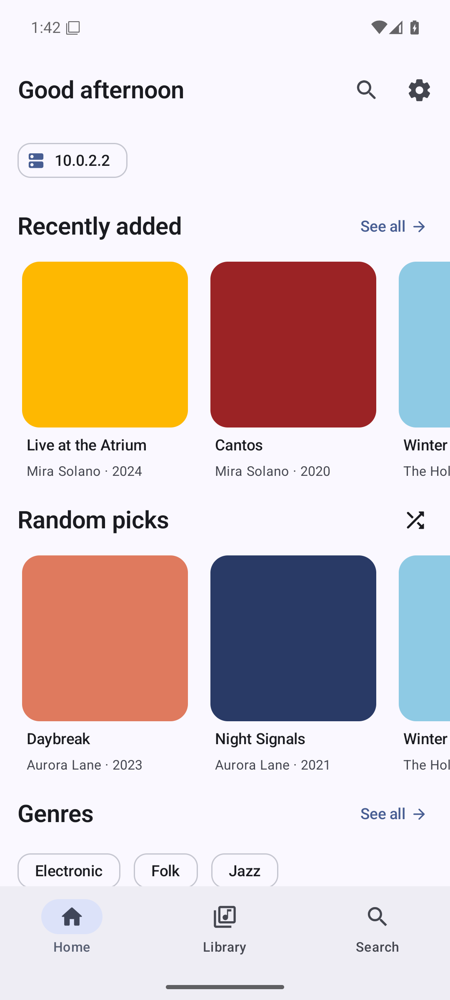
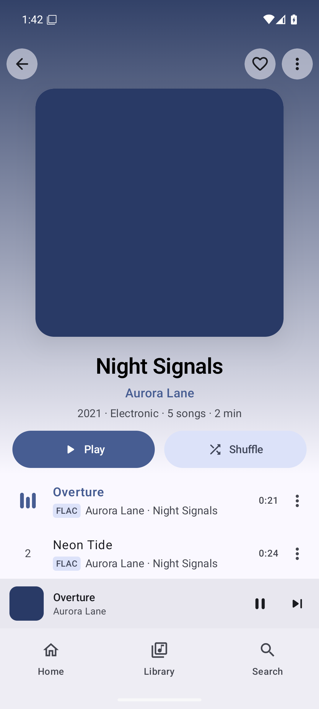
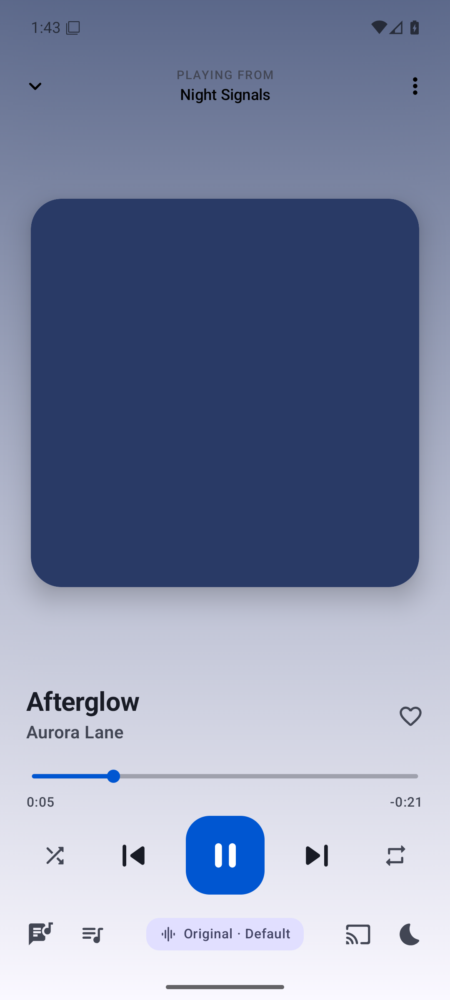
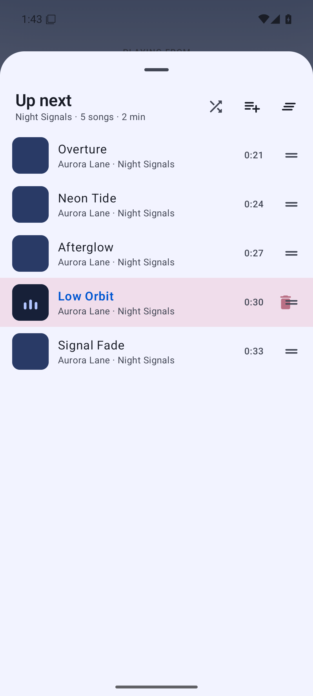
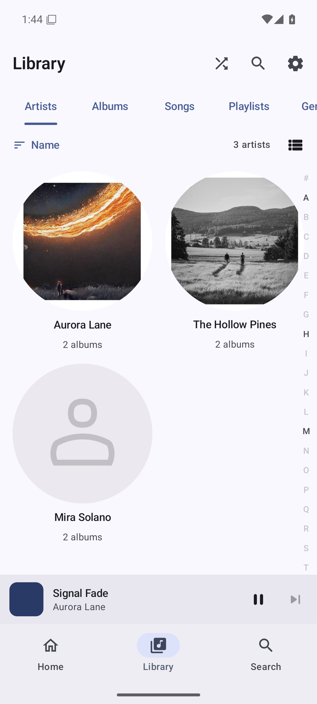
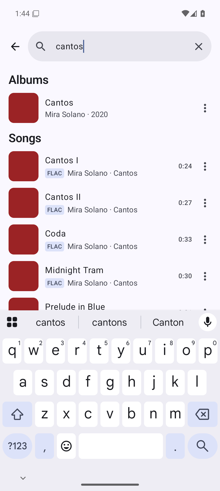
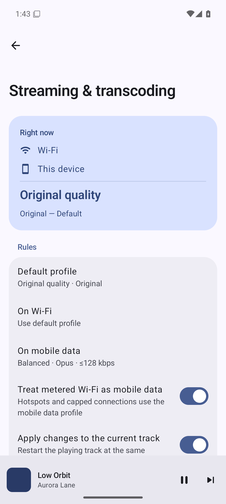
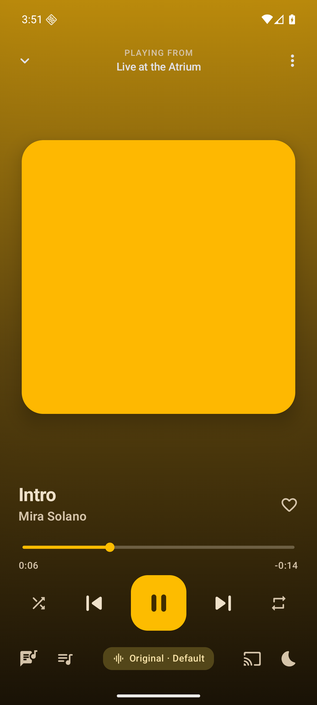

<p align="center">
  
  <strong style="font-size:1.6em">Polyphony</strong><br>
  <em>One player. Every voice.</em>
</p>

[](https://github.com/isaacault/polyphony/actions/workflows/build.yml) [](LICENSE)

Polyphony is an open-source Android music player for people who self-host their music. It is
built to be artwork-forward, fast and smooth, and unapologetically open: GPL-3.0, no accounts, no analytics, your traffic goes only to your own server.

<p align="center">
  
  
  
  
</p>
<p align="center">
  
  
  
  
</p>

<sub>Screenshots from the debug build on an Android 16 emulator against a local Navidrome test library (generated tones with solid-colour covers, hence the flat artwork).</sub>

> **Status: early alpha.** The architecture, providers, playback engine and UI are in place; the
> debug build has been exercised end to end on an emulator against Navidrome (onboarding, sync,
> browsing, search, playback, queue, settings), but not yet through a long real-world soak or on
> physical Cast and DLNA hardware. Expect rough edges and please file issues.

## What it does

**Servers**
- Subsonic / OpenSubsonic / Navidrome (salted-token auth, OpenSubsonic extensions, synced lyrics,
  ReplayGain tags, custom headers for reverse proxies, self-signed certificates)
- Jellyfin (official Kotlin SDK; favourites, playlists, instant mix, lyrics, playback reporting)
- Multiple servers, switchable from the Home screen
- [continuo](https://github.com/isaacault/continuo) servers (a request service in front of
  Navidrome): sign in with the continuo account, and "Ready to play" notifications open the album.
  Requests in the app (an *Everything* tier next to Downloaded and Library) are on the roadmap

**Library**
- Full library sync into a local Room database, so browsing, sorting and search are instant and
  work offline; incremental background syncs via WorkManager
- Home with Continue listening, Recently added, Most played, Random picks, Favourites, Playlists,
  Genres; Library tabs for Artists, Albums, Songs, Playlists, Genres with sort, grid/list and an
  A–Z fast scroller; instant local search with on-server search for anything not yet synced
- Album, Artist (bio, top songs, similar artists), Playlist (create, rename, add/remove), Genre and
  Favourites screens

**Playback**
- Media3 / ExoPlayer with gapless playback, a persistent queue that survives restarts, media
  notification and lock-screen controls, external equaliser hookup, ReplayGain (track/album/auto),
  skip silence, sleep timer, playback speed, scrobbling / now-playing reporting, an LRU stream
  cache, and a basic Android Auto / Bluetooth browse tree
- **Google Cast** with seamless local ⇄ Cast hand-off of the current queue and position
- **UPnP / DLNA renderers** (TVs, AVRs, network speakers) through a built-in control point, with
  the same queue hand-off and per-device quality settings as Cast

**Offline**
- Download songs, albums, playlists and artists at original quality or any transcoding profile
- *Download rules*: keep favourites, chosen playlists/albums/artists/genres, the last N albums
  added, or your most-played tracks on device automatically; rules re-run after every library
  sync, respect a storage cap with least-recently-played eviction, and clean up what no longer
  matches
- Offline mode shows only what is on device; downloaded files are preferred for playback

**Streaming quality engine**
- Transcoding *profiles* (built-in: Original, Lossless capped to 16/48, High Opus 256k, Balanced
  Opus 128k, Data saver Opus 64k, Cast compatible MP3 320k) plus your own
- *Rules*: a default profile, a Wi-Fi profile, a mobile-data profile, and "treat metered Wi-Fi as
  mobile"
- *Per-device profiles* for Cast and DLNA: every receiver seen on the network is remembered; pin a profile to
  each one (lossless for the hi-fi, Opus 128k for the kitchen speaker). A Cast default covers
  the rest.
- *Receiver-reachable URLs*: receivers fetch audio themselves, so each server can carry a separate
  address for Cast and DLNA (typically its LAN address) and, for plain-http servers, the app
  swaps in the LAN IP the phone resolves automatically. Lets you keep a public hostname for
  the phone without breaking casting at home.
- *Adaptive latency*: rebuffers are counted in a sliding window; crossing the threshold caps
  quality with a profile you choose, shows a chip in the player, and recovers automatically
  after a quiet period or when you tap "Restore quality". Network changes reset it.
- Decisions resolve in this order: device override → Cast default → network rule → default, with
  the latency cap applied last. The player shows the active decision and *why*.

**Look and feel**
- Material 3 Expressive, dynamic colour (Material You) or your own accent, pure-black OLED mode
- The Now Playing screen re-themes itself from the artwork, with a blurred backdrop, a swipeable
  artwork pager, a morphing play button, synced lyrics and a reorderable queue
- Edge-to-edge, predictive back, instant screen changes with a spring-driven Now Playing sheet,
  haptics where they make sense

## Building

Native (recommended on macOS/Apple Silicon — Google's Android build tools are x86_64-only on
Linux, so Docker there runs under emulation):

```sh
source scripts/env.sh          # sets JAVA_HOME (Homebrew openjdk@17) and ANDROID_HOME
./gradlew assembleDebug        # → android/app/build/outputs/apk/debug/app-debug.apk
./gradlew test                 # JVM unit tests (transcode resolver, providers, latency monitor…)
```

Requirements: JDK 17, Android SDK with `platforms;android-37.0` and `build-tools;37.0.0`
(`local.properties` points at the SDK). Toolchain: Gradle 9.8, AGP 9.4 with built-in Kotlin 2.4,
Compose BOM 2026.09, Material 3 1.4, Media3 1.11, Hilt 2.60, Room 2.8.

Containerised (any x86_64 host, and what CI uses):

```sh
docker build -t polyphony-build .
docker run --rm -v "$PWD":/src -v polyphony-gradle:/root/.gradle polyphony-build
```

## Releases

Releases are built, signed and published from the development machine:

```sh
scripts/release.sh 0.2.0 --dry-run   # build and verify the signed APK/AAB; nothing committed or pushed
scripts/release.sh 0.2.0             # bump, build, sign, verify, push main + v0.2.0, publish the GitHub Release
```

Run it on a clean `main` that matches GitHub; it runs the full local CI first if the commit has no
green `local-ci` status. It bumps `version.properties`, commits and tags locally, builds in the
`polyphony-build` image, checks that the APK is signed with the Polyphony release key (SHA-256
`169d5d82…5b8f6dca`) and carries the new version, and only then pushes and publishes. If any step
before the push fails, the local commit and tag are undone.

Signing needs no typing: the script reads `~/.config/polyphony/release.jks` and
`keystore.properties` (`storePassword`, `keyAlias`, `keyPassword`; mode 600, outside the repo;
override the folder with `POLYPHONY_SIGNING_DIR`) inside the build container. Keep a backup of both
files: Android only installs an update over an app signed with the same key.

Tags containing a dash (`v0.2.0-beta.1`) are published as pre-releases. Each release carries the
universal APK, the Play bundle, the R8 mapping file and a `.sha256` checksum list. The `Release`
workflow remains as a manual fallback (run it from the Actions tab with a tag; it signs with the
repository secrets that `scripts/create_keystore.sh` uploads). Locally, `assembleRelease` signs
with the debug key when no keystore is configured, so the R8 build can always be tested.

## Architecture

See [ARCHITECTURE.md](ARCHITECTURE.md) for the module graph, contracts and the transcoding
engine, and [DESIGN.md](DESIGN.md) for the UI rules every screen follows.

```
android:app → android:ui, android:playback, shared:data, android:dlna, android:downloads, shared:providers:* → shared:network → shared:domain
```

Adding a backend means implementing `MediaProvider` + `MediaProviderFactory` in a new
`shared:providers:*` module and binding the factory into the Hilt set — nothing else changes. See
[docs/providers.md](docs/providers.md) for the full provider contract and a step-by-step guide to
adding one.

## Roadmap

- Emby, Plex and Kodi providers; local-files provider
- Smart playlists / filter builder
- Tablet / foldable layouts, home-screen widgets, Baseline Profiles
- Quick Connect for Jellyfin; Last.fm and ListenBrainz scrobbling
- Bit-perfect USB DAC output (custom audio sink)

## Contributing

Issues and pull requests are welcome at https://github.com/isaacault/polyphony. Keep the dependency rule (`app → … → shared:domain`),
follow DESIGN.md, add unit tests for pure logic, and run `./gradlew test` before pushing.

## License

GPL-3.0-or-later. Polyphony is an independent project and is not affiliated with Jellyfin,
Navidrome or Google.

## Acknowledgements

AndroidX Media3, the Jellyfin Kotlin SDK, Coil, material-kolor, Reorderable, and the
OpenSubsonic project.
